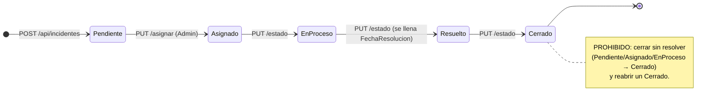
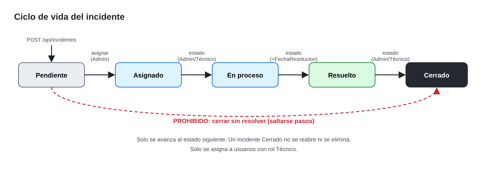

# Hoja de análisis — TechSupport Solutions

Sesión 1 · Bloque A (análisis). Contiene la tabla A1, el diagrama A2 y las decisiones A3.

---

## A1. Del problema al requerimiento

| Problema | Requerimiento (qué funcionalidad lo resuelve) | Prueba de que se resolvió |
|---|---|---|
| **Las solicitudes se pierden** entre cientos de mensajes (WhatsApp, llamadas, correo). | Registro centralizado de incidentes en una base de datos (SQLite + EF Core) mediante `POST /api/incidentes`. Cada incidente tiene Id, estado inicial `Pendiente`, prioridad y fecha de creación. `GET /api/incidentes` permite consultarlos. | Crear un incidente → **201** con su Id y estado `Pendiente`. Reiniciar la API y listarlo → sigue apareciendo (persistido en `techsupport.db`). Pruebas #5 y #6. |
| **Asignaciones poco claras**: dos técnicos atienden lo mismo y otro problema queda sin atender. | Un único campo `TecnicoId` por incidente, asignado solo por el **Administrador** con `PUT /api/incidentes/{id}/asignar`. Solo se puede asignar a usuarios con rol **Técnico**. Al asignar, el estado pasa de `Pendiente` a `Asignado`. Cada técnico solo ve sus incidentes asignados. | Asignar a un técnico → **200** y estado `Asignado`. Asignar a un usuario que no es técnico → **400**. Un técnico intenta asignar → **403**. Listar incidentes como técnico → solo aparecen los suyos. |
| **Se consulta información ajena**. | Autenticación JWT (`POST /api/auth/login`) + `[Authorize]` en todo el controlador + reglas de propiedad en `IncidenteService`: el usuario ve solo lo que creó, el técnico solo lo asignado, el administrador todo. El id de quien actúa se lee **del token**, nunca del cuerpo. | Consultar sin token → **401** (prueba #3). Usuario consulta incidente de otro → **404** (prueba #7). Técnico intenta cambiar estado de incidente ajeno → **404**. Técnico intenta eliminar → **403** (prueba #4). |
| **Errores sin registro / con detalles internos**. | `ExceptionHandlingMiddleware` al inicio del pipeline: registra el detalle completo con `ILogger` y responde **500** con un JSON genérico que incluye `requestId` (`HttpContext.TraceIdentifier`) y `timestamp`. | Provocar una excepción → **500** con `success:false`, mensaje genérico y `requestId`; el stack trace solo aparece en el log del servidor con el mismo `requestId` (prueba #9). |

---

## A2. Diagrama de estados





Versión en texto (para la hoja en papel):

```
            asignar (Admin)        estado             estado              estado
[Pendiente] ───────────────▶ [Asignado] ──────▶ [En proceso] ──────▶ [Resuelto] ──────▶ [Cerrado]
     │                                                                                     ▲
     └──────────────── X PROHIBIDO: cerrar sin resolver (saltarse pasos) ────────────────┘
                         X PROHIBIDO: Cerrado → cualquier estado (no se reabre)
```

Transiciones permitidas (solo se avanza **al siguiente**):

| Desde | Hacia | Cómo | Quién |
|---|---|---|---|
| — | Pendiente | `POST /api/incidentes` | Todos |
| Pendiente | Asignado | `PUT /api/incidentes/{id}/asignar` | Administrador |
| Asignado | En proceso | `PUT /api/incidentes/{id}/estado` | Admin o técnico asignado |
| En proceso | Resuelto | `PUT /api/incidentes/{id}/estado` (se llena `FechaResolucion`) | Admin o técnico asignado |
| Resuelto | Cerrado | `PUT /api/incidentes/{id}/estado` | Admin o técnico asignado |

Transición que el enunciado **prohíbe explícitamente**: **cerrar un incidente sin resolverlo** (cualquier salto a `Cerrado` desde un estado distinto de `Resuelto`). También se prohíbe reabrir un `Cerrado`.

---

## A3. Decisiones

### Decisión 1 — Incidente ajeno: ¿403 o 404?

**Respondemos 404 Not Found** cuando alguien consulta o modifica un incidente que existe pero no le corresponde.

- **Por qué:** el 404 no confirma que el recurso existe; con 403 un atacante podría recorrer ids (`/1`, `/2`, `/3`…) y saber cuántos incidentes hay y cuáles existen (enumeración).
- **Qué pasaría si no:** con 403 se filtra información (existencia de incidentes ajenos) aunque no se muestre el contenido.
- **Mismo criterio en toda la API:** `GET /{id}` y `PUT /{id}/estado` de un incidente ajeno → 404.
  El **403** se reserva para cuando el **rol** no permite la operación (p. ej. técnico que intenta `DELETE` o `asignar`): ahí no se revela nada del incidente, porque la petición se rechaza antes de mirarlo.

### Decisión 2 — ¿Puede el administrador eliminar un incidente Cerrado?

**No.** Un incidente `Cerrado` no se puede eliminar (la API responde **400** con un mensaje claro). Sí se pueden eliminar incidentes en otros estados (p. ej. duplicados o creados por error).

- **Por qué:** un incidente cerrado es el **historial** del servicio: qué pasó, quién lo atendió, cuánto tardó (`FechaCreacion` → `FechaResolucion`).
- **Qué se pierde si lo hace:** trazabilidad y auditoría (no se puede demostrar que el problema se atendió), métricas de tiempos de resolución por técnico y la evidencia si el problema vuelve a aparecer.
