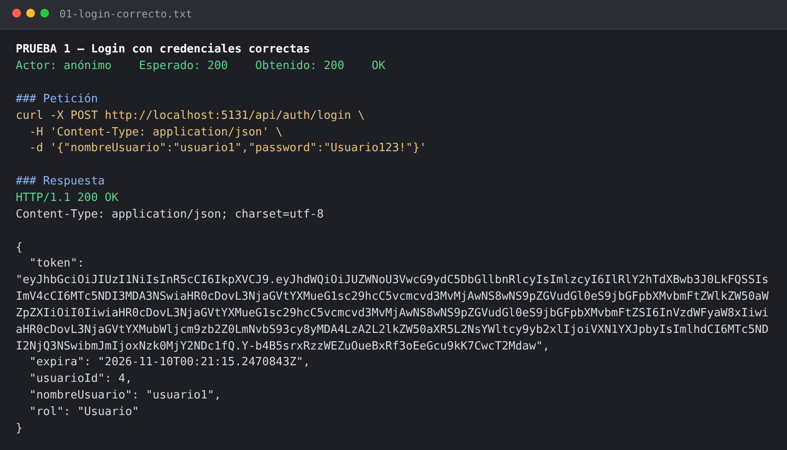
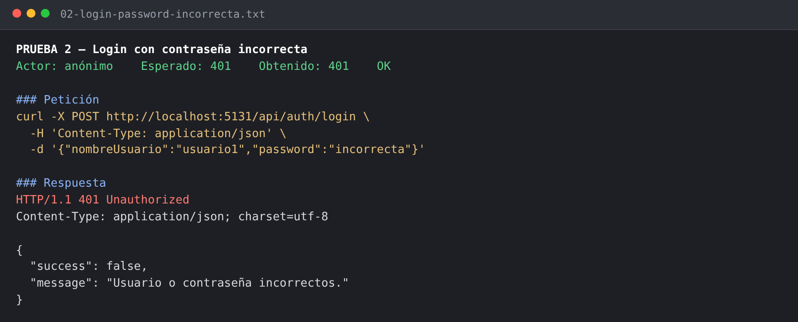
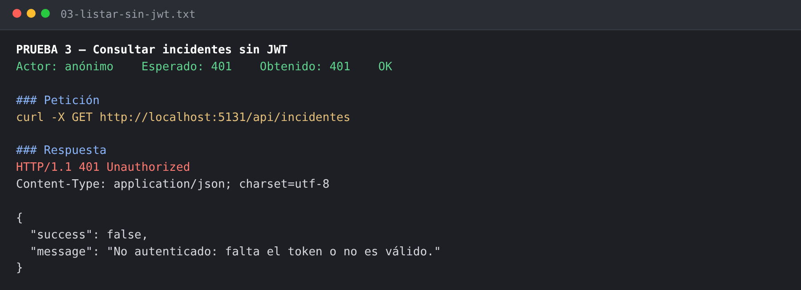
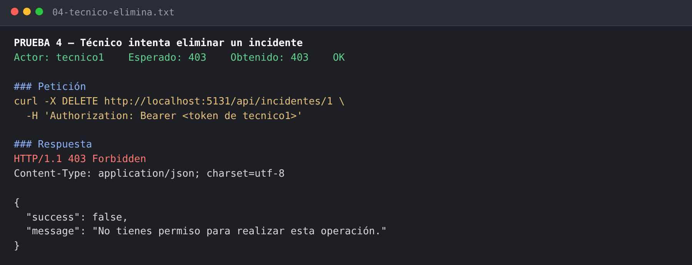
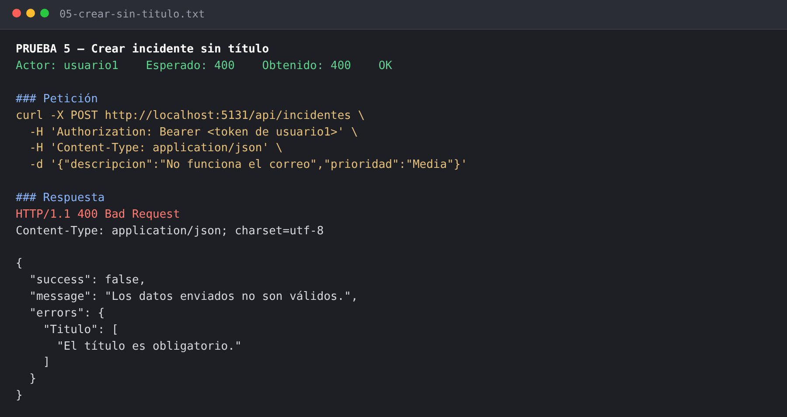
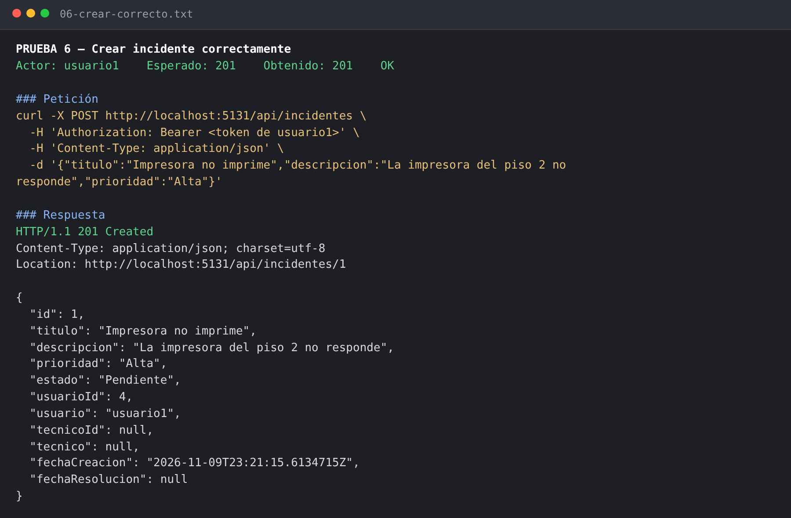
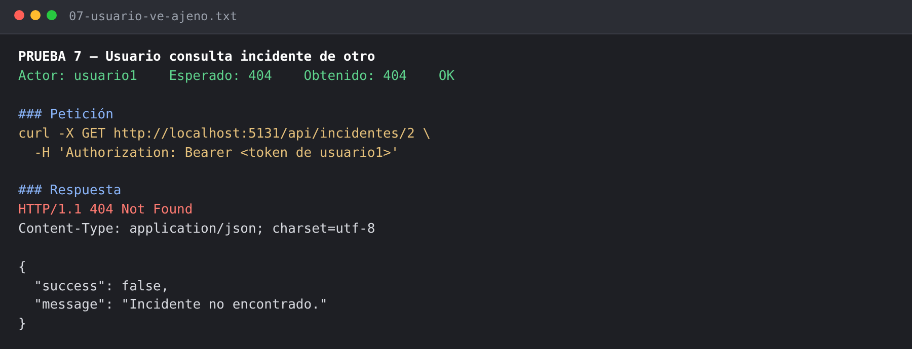
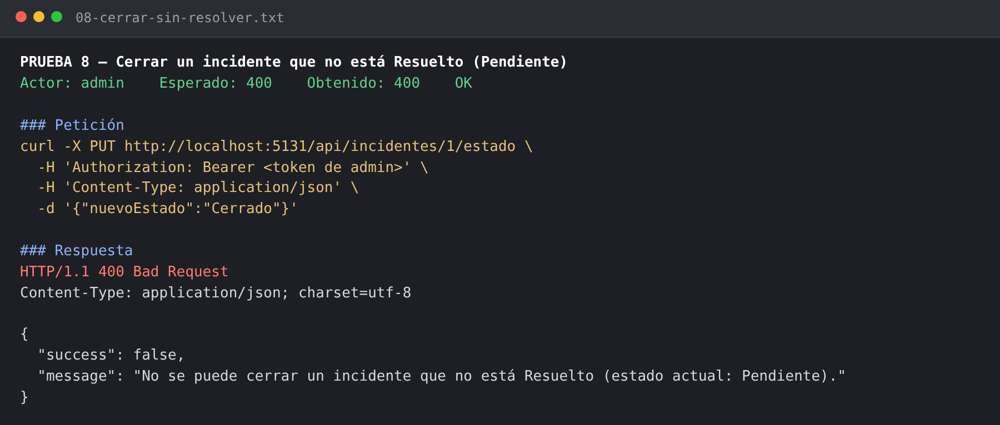
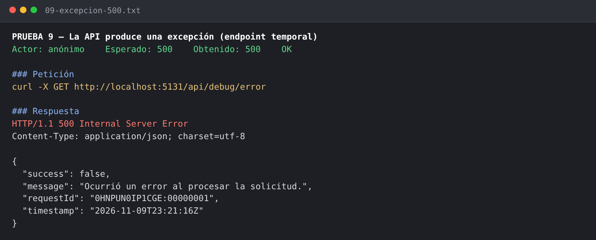
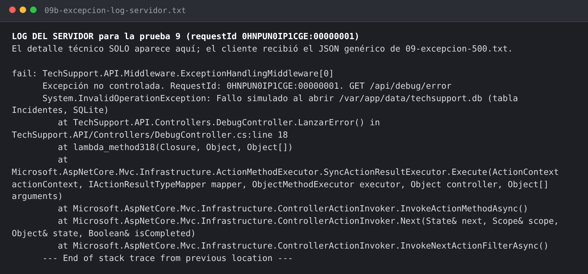

# Tabla de pruebas con evidencia

Pruebas ejecutadas contra la API real (`dotnet run`, base de datos nueva) con
[`scripts/pruebas.sh`](../scripts/pruebas.sh). Cada evidencia muestra la **petición** y la **respuesta HTTP**
(texto en `docs/evidencias/*.txt`, captura en `docs/evidencias/capturas/*.png`).
Resultado completo: [evidencias/RESUMEN.md](evidencias/RESUMEN.md) — **26/26 OK**.

Usuarios de prueba: `admin` (Id 1), `tecnico1` (Id 2), `tecnico2` (Id 3), `usuario1` (Id 4), `usuario2` (Id 5).

## Sección 6 del enunciado

| # | Prueba | Resultado esperado | Obtenido | Evidencia |
|---|---|---|---|---|
| 1 | Login con credenciales correctas | 200 y token | 200 + `token` | [texto](evidencias/01-login-correcto.txt) · [captura](evidencias/capturas/01-login-correcto.png) |
| 2 | Login con contraseña incorrecta | 401 | 401 `"Usuario o contraseña incorrectos."` | [texto](evidencias/02-login-password-incorrecta.txt) · [captura](evidencias/capturas/02-login-password-incorrecta.png) |
| 3 | Consultar incidentes sin JWT | 401 | 401 | [texto](evidencias/03-listar-sin-jwt.txt) · [captura](evidencias/capturas/03-listar-sin-jwt.png) |
| 4 | Técnico intenta eliminar un incidente | 403 | 403 | [texto](evidencias/04-tecnico-elimina.txt) · [captura](evidencias/capturas/04-tecnico-elimina.png) |
| 5 | Crear incidente sin título | 400 | 400 `"El título es obligatorio."` | [texto](evidencias/05-crear-sin-titulo.txt) · [captura](evidencias/capturas/05-crear-sin-titulo.png) |
| 6 | Crear incidente correctamente | 201 | 201, estado `Pendiente` | [texto](evidencias/06-crear-correcto.txt) · [captura](evidencias/capturas/06-crear-correcto.png) |
| 7 | Usuario consulta incidente de otro | 403 o 404 (decisión A3: **404**) | 404 | [texto](evidencias/07-usuario-ve-ajeno.txt) · [captura](evidencias/capturas/07-usuario-ve-ajeno.png) |
| 8 | Cerrar un incidente que no está Resuelto | 400 | 400 `"No se puede cerrar un incidente que no está Resuelto (estado actual: Pendiente)."` | [texto](evidencias/08-cerrar-sin-resolver.txt) · [captura](evidencias/capturas/08-cerrar-sin-resolver.png) |
| 9 | La API produce una excepción | 500 controlado, sin datos internos | 500 con `success`, `message`, `requestId`, `timestamp` | [texto](evidencias/09-excepcion-500.txt) · [captura](evidencias/capturas/09-excepcion-500.png) · [log del servidor](evidencias/09b-excepcion-log-servidor.txt) |

> La prueba 9 se hizo con el endpoint temporal `GET /api/debug/error`, que lanza una excepción con
> "detalles internos" (ruta de la BD, nombre de tabla). El cliente solo recibe el mensaje genérico;
> el detalle queda en el log con el mismo `requestId`. El endpoint se **borró** después
> (commit "Eliminar endpoint temporal de prueba…").

### Capturas de la sección 6

| | |
|---|---|
|  |  |
|  |  |
|  |  |
|  |  |
|  |  |

## Casos críticos y reglas adicionales

| # | Prueba | Esperado | Obtenido | Evidencia |
|---|---|---|---|---|
| 10 | Login con usuario inexistente (mismo mensaje que #2) | 401 | 401, mismo mensaje | [texto](evidencias/10-login-usuario-inexistente.txt) |
| 11 | Asignar a un usuario que no es Técnico (caso 3) | 400 | 400 | [texto](evidencias/11-asignar-no-tecnico.txt) |
| 12 | Usuario intenta asignar técnico | 403 | 403 | [texto](evidencias/12-usuario-asigna.txt) |
| 13 | Admin asigna a tecnico1 (Pendiente → Asignado) | 200 | 200, estado `Asignado` | [texto](evidencias/13-asignar-tecnico.txt) |
| 14 | tecnico2 cambia estado de incidente de tecnico1 (caso 1) | 404 | 404 | [texto](evidencias/14-tecnico-modifica-ajeno.txt) |
| 15 | tecnico2 consulta incidente de tecnico1 (caso 1) | 404 | 404 | [texto](evidencias/15-tecnico-ve-ajeno.txt) |
| 16 | Saltar pasos: Asignado → Resuelto (caso 3) | 400 | 400 | [texto](evidencias/16-saltar-paso.txt) |
| 17 | tecnico1: Asignado → EnProceso | 200 | 200 | [texto](evidencias/17-en-proceso.txt) |
| 18 | tecnico1: EnProceso → Resuelto | 200 + `fechaResolucion` | 200, `fechaResolucion` llena | [texto](evidencias/18-resuelto.txt) |
| 19 | tecnico1: Resuelto → Cerrado | 200 | 200 | [texto](evidencias/19-cerrado.txt) |
| 20 | Reabrir un Cerrado | 400 | 400 | [texto](evidencias/20-reabrir-cerrado.txt) |
| 21 | Admin elimina un Cerrado (decisión A3) | 400 | 400 | [texto](evidencias/21-eliminar-cerrado.txt) |
| 22 | tecnico1 lista: solo sus asignados | 200 | 200, solo el suyo | [texto](evidencias/22-listar-tecnico.txt) |
| 23 | usuario2 lista: solo los que creó | 200 | 200, solo el suyo | [texto](evidencias/23-listar-usuario.txt) |
| 24 | admin lista: todos | 200 | 200, ambos | [texto](evidencias/24-listar-admin.txt) |
| 25 | Admin elimina un incidente Pendiente | 204 | 204 | [texto](evidencias/25-admin-elimina.txt) |
| 26 | Token manipulado (firma inválida) | 401 | 401 | [texto](evidencias/26-token-falso.txt) |

Todas las capturas están en [`evidencias/capturas/`](evidencias/capturas/). Swagger UI:
[`00-swagger-ui.png`](evidencias/capturas/00-swagger-ui.png).
